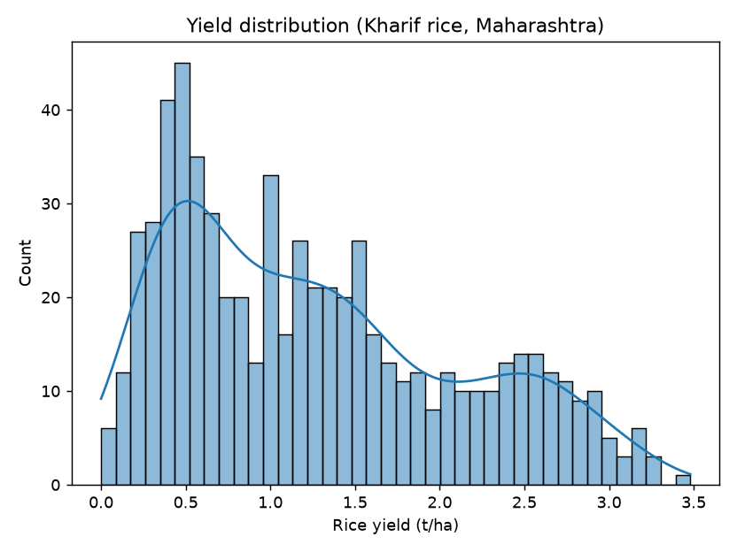
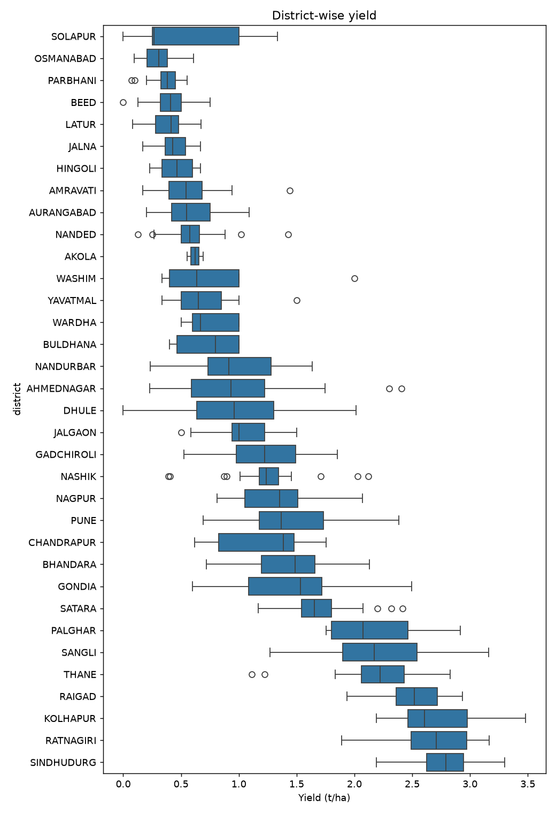
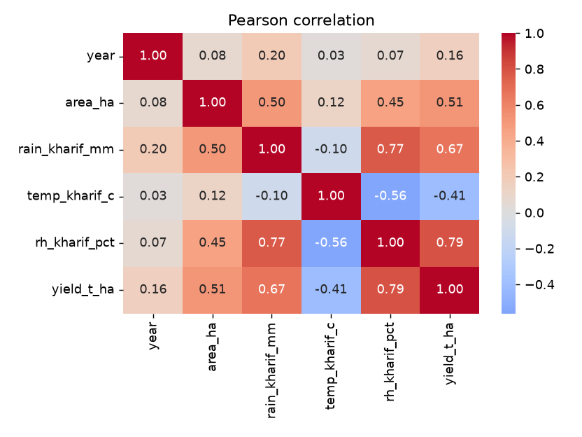
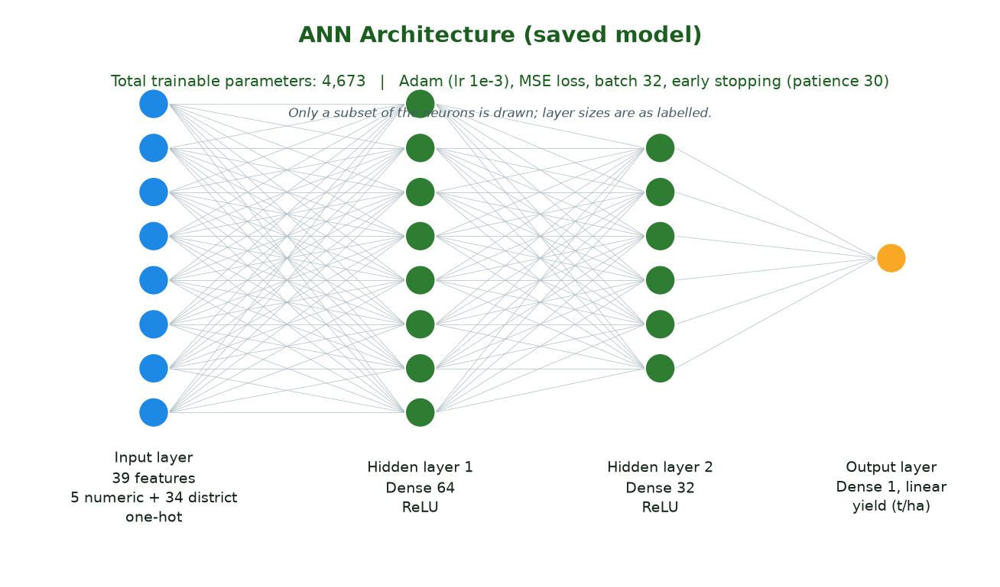
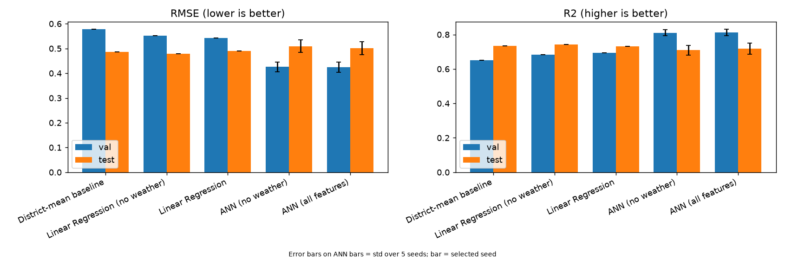
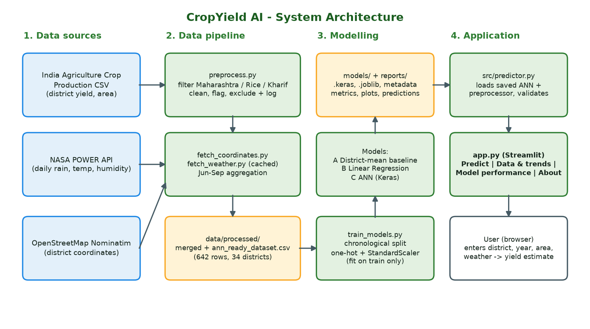
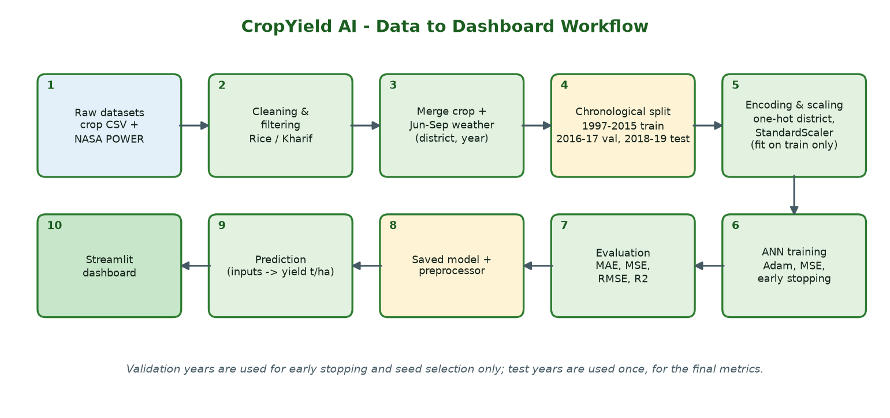

# CropYield AI: ANN-Based Rice Yield Prediction for Maharashtra

**Soft Computing Mini Project**
Team members: *[add names and roll numbers]* | Guide: *[add]* | Institution / Department: *[add]* | Date: *[add]*

> All numbers in this report are taken from the project's own output files (`reports/`, `models/`, `data/processed/`).
> Where the results are disappointing for the ANN, they are reported as they are.

---

## 1. Project Title
**CropYield AI: ANN-Based Rice Yield Prediction for Maharashtra, India**

## 2. Abstract
This project builds an Artificial Neural Network (ANN) that estimates Kharif rice yield (tonnes per hectare) for the
districts of Maharashtra from the agricultural year, cultivated area and June–September rainfall, temperature and
humidity. District-level crop records (1997–2019) were cleaned and merged with satellite-reanalysis weather from the
NASA POWER API, giving **642 genuine observations from 34 districts**. Data were split chronologically (train 1997–2015,
validation 2016–2017, test 2018–2019) and three models were compared: a district-mean baseline, Linear Regression and a
small ANN (39 → 64 → 32 → 1, 4,673 parameters). The ANN was the best model on the validation years (RMSE 0.424 t/ha,
R² 0.813) but **did not beat the simple baselines on the test years** (ANN RMSE 0.502 t/ha vs 0.486 for the district-mean
baseline and 0.489 for Linear Regression). Removing the weather inputs did not hurt, so within this small dataset the
weather features added little beyond knowing the district. A Streamlit web application lets a user enter inputs and
obtain a yield estimate. The work is an academic prototype and demonstrates the full pipeline: data preparation,
leakage-free modelling, honest evaluation and deployment.

## 3. Introduction
Rice is a major Kharif (monsoon-season) crop in Maharashtra, grown mainly in the Konkan, eastern Vidarbha and western
Ghat regions. Yield varies strongly from district to district and from year to year because of rainfall, temperature,
soil, irrigation and farming practice. Being able to estimate yield from available data is useful for planning, storage
and policy. Soft-computing methods such as ANNs can learn non-linear relationships from data without an explicit crop
model, which makes them a natural choice for this type of problem.

## 4. Problem Statement
Design and develop an artificial neural network to predict the yield of a specific crop (Kharif rice) based on weather
conditions for selected geospatial areas (districts of Maharashtra) under cultivation, and compare it fairly against
simpler models.

## 5. Objectives
1. Build a clean, documented district-year dataset of Kharif rice yield for Maharashtra.
2. Add weather features (June–September rainfall, temperature, humidity) for every district from a public source.
3. Train an ANN to predict yield (t/ha) and evaluate it on unseen future years.
4. Compare the ANN with a district-mean baseline and Linear Regression, and test whether weather helps.
5. Provide a simple web interface for prediction and for exploring the data and results.

## 6. Existing System and Proposed System
**Existing approach.** Official yield figures come from field surveys and crop-cutting experiments reported after the
harvest, so they are accurate for the past but not available as an estimate from weather and area data alone.
Published studies of rice yield prediction using ANNs and SVMs exist (see references [8], [9]).

**Proposed system.** A data-driven pipeline that (a) merges district crop statistics with NASA POWER weather, (b) trains
an ANN and two reference models with a strict chronological split, and (c) serves the saved ANN through a Streamlit
dashboard. The system is evaluated honestly against simple baselines rather than assumed to be better.

## 7. Dataset Description and Sources
| Item | Description |
|---|---|
| Crop data | `India Agriculture Crop Production.csv` supplied by the team: 345,407 rows for all of India (columns State, District, Crop, Year, Season, Area, Area Units, Production, Production Units, Yield). *[Add the original publisher/URL of this file.]* |
| Filter applied | State = Maharashtra (17,922 rows) → Crop = Rice (874) → Season = Kharif (**646**) |
| Units | Area in hectares, production in tonnes; yield = production ÷ area in t/ha (verified: 0 mismatches in 643 rows with production) |
| Period | Crop years 1997-98 to 2019-20 (Kharif year = start year, 1997–2019) |
| Weather | NASA POWER daily API (MERRA-2 reanalysis): `PRECTOTCORR` (mm/day), `T2M` (°C), `RH2M` (%), 1997–2020, 298,044 daily rows for 34 districts, no missing values |
| Locations | One representative point per district: centre of the district boundary from OpenStreetMap Nominatim (`data/raw/district_coordinates.csv`) |
| Validation of the weather download | The API download for Pune's coordinates reproduced the team's reference file with zero difference on 7,671 overlapping days. The Pune file itself was *not* used as weather for other districts. |

## 8. Data Preprocessing
Implemented in `preprocess.py`; the full log is in `reports/preprocessing_log.md` and `reports/data_quality_report.md`.

| Step | Decision and result |
|---|---|
| Year mapping | "2005-06" is matched to calendar year 2005 (Kharif is sown in June–July and harvested Oct–Dec of that year). The file does not state this; it is the standard Indian crop-year convention. |
| Missing / duplicate / invalid | Missing production in 3 rows; no exact duplicates; no repeated district-year rows; no non-positive areas. |
| Excluded (4 rows, each logged) | 3 rows with missing production (placeholder yield 0.0, 100–300 ha). 1 row, **Kolhapur 1997-98**, with yield 223.73 t/ha: its area is 1,100 ha while Kolhapur's area is about 105,000 ha in every other year, so the area is almost certainly mistyped. The true value cannot be recovered, so the row was excluded, not edited. |
| Retained | **642** crop records. |
| Flagged but kept | 97 rows with area < 1,000 ha (3 with production 0). Production is rounded to the nearest 100 t there, so yield is coarse. 14 rows are within-district statistical outliers (|robust z| > 3.5); all kept. |
| Weather aggregation | June–September: total rainfall (mm), mean temperature (°C), mean relative humidity (%) per district-year. All seasons had ≥ 90 % valid days (none needed to be dropped). |
| Merge | Crop × weather on district + year, one-to-one: 0 unmatched, 0 duplicates → **642 rows**. |
| Leakage control | Production is not a model input. Scaling and encoding are fitted on training years only (Section 11). |

## 9. Exploratory Data Analysis
Figures are in `reports/eda/`; statistics in `reports/eda/eda_summary.md`.

| Variable | Mean | Std | Min | Max |
|---|---|---|---|---|
| Yield (t/ha) | 1.265 | 0.840 | 0.00 | 3.48 |
| Area (ha) | 52,980 | 58,357 | 5 | 311,400 |
| Rainfall Jun–Sep (mm) | 1,007 | 574 | 265 | 3,406 |
| Mean temperature (°C) | 26.39 | 1.32 | 23.46 | 29.08 |
| Mean humidity (%) | 79.9 | 5.4 | 66.9 | 91.6 |

**Correlation with yield (Pearson).**

| Feature | All rows | After removing district means |
|---|---|---|
| Humidity | 0.794 | 0.150 |
| Rainfall | 0.670 | 0.177 |
| Area | 0.514 | 0.067 |
| Temperature | −0.407 | −0.077 |
| Year | 0.161 | 0.180 |

The strong overall correlations mostly reflect *differences between districts* (for example wet, high-yielding Konkan
districts). Within a single district, year-to-year weather explains much less. This foreshadows the modelling result.

**Data coverage.** Records per district range from 23 (full history) down to 2 for Akola, 6 for Palghar and 7 for
Buldhana; some districts were created later or have gaps.

## 10. ANN Architecture and Working

- **Input (39 values):** 5 numeric features (year, area, rainfall, temperature, humidity; standardised) + 34 one-hot columns for district.
- **Hidden layer 1:** Dense, 64 neurons, ReLU. **Hidden layer 2:** Dense, 32 neurons, ReLU.
- **Output:** 1 neuron, linear activation, predicting yield in t/ha.
- **Parameters:** 4,673 (39×64+64 + 64×32+32 + 32+1).

Each neuron computes a weighted sum of its inputs plus a bias and applies an activation. ReLU lets the network model
non-linear effects (for example diminishing returns of rain). Training adjusts the weights by gradient descent to
reduce the mean squared error between predicted and actual yield. A small network was chosen on purpose because only
540 training rows are available.

## 11. Model Training Methodology
- **Library:** TensorFlow/Keras (script `train_models.py`).
- **Optimizer / loss:** Adam (learning rate 1e-3), mean squared error, batch size 32, up to 500 epochs.
- **Early stopping:** monitor validation loss, patience 30, restore best weights. For the saved ANN the best validation loss was at epoch 14, and training stopped after 44 epochs.
- **Preprocessing:** `StandardScaler` for numeric features and `OneHotEncoder(handle_unknown="ignore")` for district, both **fitted on the training years only** and applied to validation and test.
- **Seeds:** the ANN was trained with 5 random seeds (0–4). The saved model is the seed with the lowest *validation* loss (seed 0). The test set was never used to choose anything.
- **Target:** yield in t/ha, not scaled. **Production is not used as an input.**

## 12. Chronological Train / Validation / Test Split
Random splitting would let the model learn from the future, so the data are split by year:

| Set | Years | Rows | Purpose |
|---|---|---|---|
| Training | 1997–2015 | **540** | fit scalers, encoder and weights |
| Validation | 2016–2017 | **51** | early stopping, seed selection |
| Test | 2018–2019 | **51** | final one-time evaluation |

Every district in the validation and test sets also appears in the training set, so no unseen-district fallback was needed
(the baseline's fallback, the overall training mean 1.211 t/ha, was therefore never used).

## 13. Baseline and Model Comparison
- **Model A, District-mean baseline:** predicts each district's average yield in the training years.
- **Model B, Linear Regression:** same features as the ANN (district one-hot encoded).
- **Model C, ANN:** as in Section 10.
- **Extra experiments:** ANN and Linear Regression *without* the three weather inputs, to test whether weather helps.

## 14. Evaluation Metrics
- **MAE** = mean(|actual − predicted|), in t/ha. **MSE** = mean((actual − predicted)²). **RMSE** = √MSE, in t/ha, penalises large errors.
- **R²** = 1 − (sum of squared errors ÷ total variance); 1 is perfect, 0 equals predicting the mean.

Results (`reports/model_comparison.csv`; ANN rows are the selected seed):

| Model | Split | MAE | MSE | RMSE | R² |
|---|---|---|---|---|---|
| District-mean baseline | val | 0.4667 | 0.3348 | 0.5786 | 0.6512 |
| | test | 0.4272 | 0.2363 | 0.4861 | 0.7349 |
| Linear Regression | val | 0.4307 | 0.2938 | 0.5420 | 0.6939 |
| | test | 0.4229 | 0.2395 | 0.4894 | 0.7313 |
| Linear Regression (no weather) | val | 0.4459 | 0.3053 | 0.5525 | 0.6819 |
| | test | 0.4228 | 0.2286 | 0.4781 | 0.7436 |
| ANN (all features) | val | 0.3373 | 0.1800 | 0.4242 | 0.8125 |
| | test | 0.3807 | 0.2515 | 0.5015 | 0.7178 |
| ANN (no weather) | val | 0.3437 | 0.1816 | 0.4262 | 0.8107 |
| | test | 0.4103 | 0.2594 | 0.5093 | 0.7091 |

Seed variability of the ANN (mean ± std over 5 seeds):

| ANN variant | Val RMSE | Test RMSE | Test R² |
|---|---|---|---|
| All features | 0.453 ± 0.021 | 0.542 ± 0.027 | 0.670 ± 0.032 |
| No weather | 0.459 ± 0.020 | 0.471 ± 0.026 | 0.751 ± 0.027 |

## 15. System Architecture

The pipeline is a set of re-runnable Python scripts (`fetch_coordinates.py`, `fetch_weather.py`, `preprocess.py`,
`eda.py`, `train_models.py`). The Streamlit app reads only the saved artefacts: it never retrains the model.

## 16. Technology Stack
| Purpose | Tool |
|---|---|
| Language | Python 3.13 (3.11+ should work) |
| Data handling | pandas, NumPy |
| Preprocessing, baselines | scikit-learn (StandardScaler, OneHotEncoder, LinearRegression, metrics) |
| ANN | TensorFlow / Keras 2.21 |
| Weather and geocoding | NASA POWER API, OpenStreetMap Nominatim (via `requests`) |
| Visualisation | Matplotlib, Seaborn (reports); Altair (app) |
| Web app | Streamlit |
| Persistence | `.keras` (ANN), `joblib` (preprocessor, Linear Regression), JSON (metadata) |
| Testing | pytest + Streamlit AppTest |

## 17. Streamlit Application Features
Run with `streamlit run app.py`. Sidebar navigation with four pages:
1. **Predict yield**: choose a district, then enter year, area, rainfall, temperature and humidity (defaults are that district's historical medians). The result shows predicted yield (t/ha), an *estimated* production (yield × area), and the district's historical average for context. Inputs are validated (e.g. area > 0, humidity 0–100 %), and values outside the training range give an extrapolation warning.
2. **Data & trends**: yearly mean yield with optional district overlays, and district-wise average yield.
3. **Model performance**: metric cards, the full metrics table, RMSE comparison and an actual-vs-predicted plot, all read from the saved Phase 3 results. It displays a warning when the ANN does not beat the baselines.
4. **About & limitations**: architecture, input ranges, data sources, limitations and disclaimer.

## 18. Results and Discussion
1. **Validation vs test.** The ANN was clearly best on the validation years (RMSE 0.424 vs 0.542–0.579 for the others), but on the test years it was slightly *worse* than the district-mean baseline (0.502 vs 0.486) and Linear Regression (0.489). The best test RMSE came from Linear Regression without weather (0.478). The ANN's advantage did not carry over to 2018–2019.
2. **Weather contribution.** With seed averaging the ANN with weather had a *worse* test RMSE (0.542 ± 0.027) than without (0.471 ± 0.026); on validation the two were equal (0.453 vs 0.459). For Linear Regression, weather also did not help on test (0.489 with vs 0.478 without). In this dataset, weather inputs gave no reliable improvement.
3. **Why?** Most yield variation is between districts, which the baseline already captures. Within a district, yearly weather explains little (within-district correlations of 0.15–0.18). Weather comes from a single grid point per district, and only 540 rows are available for 34 districts.
4. **Noise.** The test set is only 51 rows (2 years) and the ANN's seed-to-seed spread (±0.03 RMSE) is as large as most differences between models, so small gaps should not be over-interpreted.
5. **Usefulness.** All models explain roughly 67–74 % of the variance on test years (R² 0.67–0.74), but this is largely the district effect. The model should be seen as a working prototype, not a demonstrated improvement over simple averages.

Test-set plots: `reports/model_plots/02_actual_vs_predicted_test.png`, `03_residuals_test.png`; training curves: `01_loss_curves.png`.

## 19. Limitations
- Only **642** observations (540 train / 51 validation / 51 test); the test result rests on two years.
- **Four pairs of districts share a NASA grid cell** (identical weather): Hingoli/Parbhani, Akola/Amravati, Nagpur/Wardha, Bhandara/Gondia.
- District weather is a **single representative point**, not a district average, and MERRA-2 is a reanalysis product, not rain-gauge data.
- The weather window is June–September only; Kharif rice is often harvested in October–November.
- Weather values are known only after the season, so this is retrospective estimation, not an early forecast.
- No soil, irrigation, fertiliser or variety data; irrigated and rain-fed rice are mixed.
- Some districts have few records (Akola 2, Palghar 6, Buldhana 7), and district boundaries changed over time.
- Small-area rows (97, of which 17 in validation/test) have coarsely rounded yields.
- The `year` input extrapolates beyond the training range for later years.
- Correlation does not establish causation.
- This is an academic prototype and must not be used for real farming, insurance or policy decisions.

## 20. Future Scope
- Obtain district-averaged or gauge-based rainfall (e.g. IMD data) and use several points per district.
- Add soil, irrigation, fertiliser and sowing-date information, and satellite vegetation indices.
- Include October weather and growth-stage features; build true early-season forecasts.
- Try regularised models and tree ensembles, cross-validation by year (rolling origin), and hyper-parameter search (including genetic algorithms or other soft-computing optimisers).
- Extend to other crops and states, and add prediction intervals.

## 21. Conclusion
The project delivers a complete, reproducible pipeline from raw data to a working web application: a documented dataset
of 642 district-year rice records with matching weather, a leakage-free chronological evaluation, and an ANN that is
served in a Streamlit dashboard. The honest finding is that, with the available data, the ANN improved on the validation
years but did not outperform a district-mean baseline or Linear Regression on the test years, and the weather inputs did
not add reliable predictive value. This points to data limitations (small size, coarse weather, missing soil and
irrigation information) rather than to a failure of the method, and the future-scope steps above outline how to improve it.

## 22. References
1. NASA Langley Research Center, *Prediction Of Worldwide Energy Resource (POWER) Project*. https://power.larc.nasa.gov/ (API docs: https://power.larc.nasa.gov/docs/)
2. Gelaro, R. et al. (2017). The Modern-Era Retrospective Analysis for Research and Applications, Version 2 (MERRA-2). *Journal of Climate*, 30(14), 5419–5454.
3. OpenStreetMap contributors, Nominatim geocoding service. https://nominatim.org (data © OpenStreetMap, ODbL).
4. Pedregosa, F. et al. (2011). Scikit-learn: Machine Learning in Python. *Journal of Machine Learning Research*, 12, 2825–2830.
5. Abadi, M. et al. (2016). TensorFlow: Large-Scale Machine Learning on Heterogeneous Systems. arXiv:1603.04467. Keras: https://keras.io
6. Kingma, D. P., & Ba, J. (2015). Adam: A Method for Stochastic Optimization. ICLR. arXiv:1412.6980.
7. Streamlit documentation. https://docs.streamlit.io
8. "Rice crop yield prediction using artificial neural networks", Edith Cowan University research repository. https://ro.ecu.edu.au/ecuworkspost2013/3518/ *[add authors/year from the page]*
9. "Rice crop yield prediction in India using support vector machines", Edith Cowan University research repository. https://ro.ecu.edu.au/ecuworkspost2013/2744 *[add authors/year from the page]*

*Please verify the reference details against the original sources before submission.*

---

## Appendix A: Project files for this report
| What | Where |
|---|---|
| Final dataset | `data/processed/ann_ready_dataset.csv` (+ `maharashtra_rice_kharif_merged.csv`) |
| Data quality / preprocessing | `reports/data_quality_report.md`, `reports/preprocessing_log.md` |
| Model results | `reports/model_evaluation_report.md`, `reports/model_comparison.csv`, `reports/predictions.csv`, `reports/ann_seed_results.csv` |
| Saved models | `models/ann_model.keras`, `models/preprocessor.joblib`, `models/linear_regression_model.joblib`, `models/model_metadata.json` |
| Tests | `tests/test_project.py` (28 tests) |
